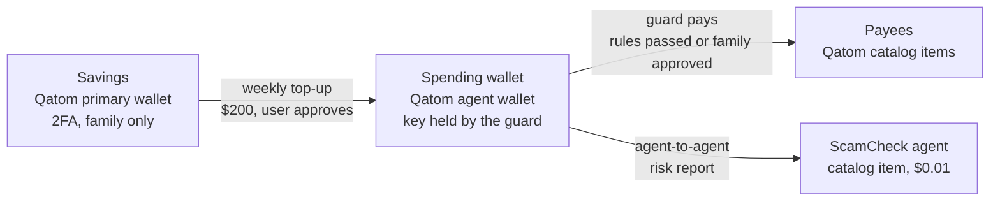
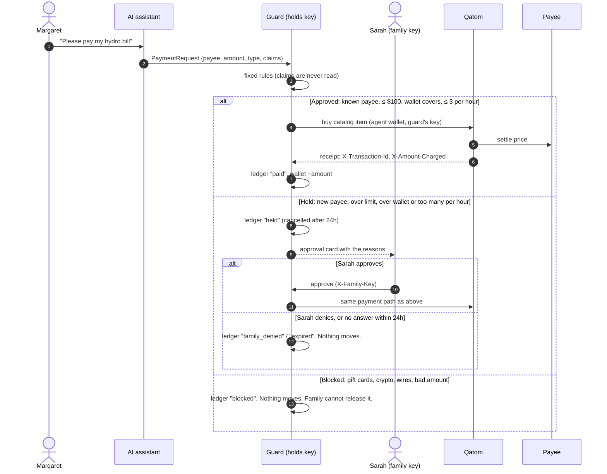
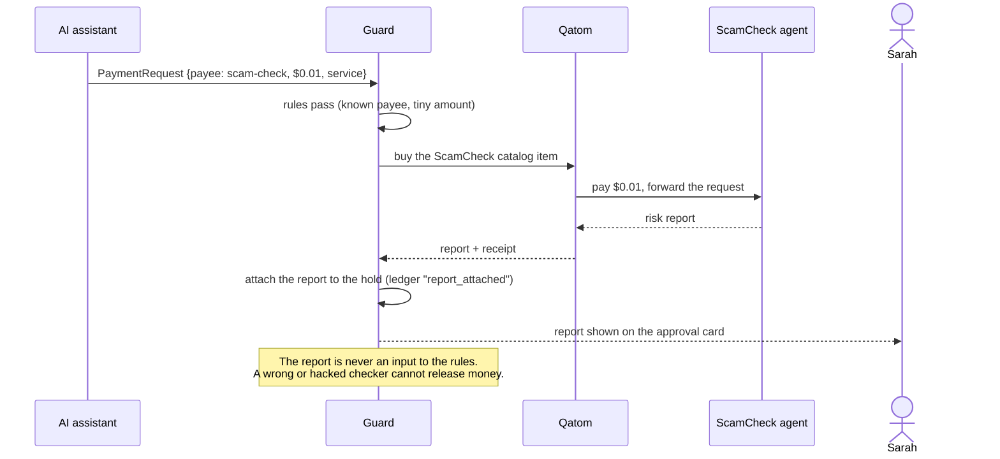

# Payment and value flow

Who pays whom, from which wallet, who authorizes each move, and where it is recorded.

## The parties

| Party | Role | Holds | Can it move money? |
| --- | --- | --- | --- |
| **Margaret** (the senior) | Owns the money and asks the assistant to pay | Nothing directly | Only by asking |
| **AI assistant** | Turns her words into a payment request | No key of any kind | No. It can only ask the guard. |
| **Guard** | Checks every request against fixed rules, then pays, holds or blocks | **The spending wallet's key** | Yes, but only what the rules allow |
| **Sarah** (her daughter) | Approves or denies held payments, tops up the wallet | The family key | Yes, but only by releasing a hold the guard created, or by a top-up |
| **Payment rail** (Qatom) | Settles payments and returns receipts | The wallets themselves | Moves money when the guard's key signs |
| **Payees** | Toronto Hydro, Rogers, Shoppers… On Qatom, each is a catalog item. | Their receiving wallet | Receive only |
| **ScamCheck agent** | A second AI agent that sells risk reports for $0.01 | Its receiving wallet | Receives only |

## Where the money sits

- **Savings never pay anyone.** The only way out of savings is a top-up into the spending wallet, and Qatom always asks the user to approve that.
- **The spending wallet is the ceiling.** Every payment comes from it, so the most that can ever be lost in a week is what's in it ($200).

## Three paths for one request

## Agent to agent: buying a scam check

When a payment to someone new is held, the assistant buys a risk report from another agent. That purchase is itself a payment, so it goes through the guard like any other.

## Every value movement

| Event | From → to | Amount | Authorized by | Ledger entry | On Qatom |
| --- | --- | --- | --- | --- | --- |
| Weekly top-up | Savings → spending wallet | Up to $200 | Schedule, plus the user's approval on Qatom | `weekly_topup` | `transfer_to_agent` (always asks the user) |
| Family top-up | Savings → spending wallet | Any | Sarah (family key) | `topup` | `transfer_to_agent` |
| Everyday payment | Spending wallet → payee | ≤ $100 | Guard rules | `request`, `paid` | `POST /v4/paywall {catalog_item_id}` |
| Released hold | Spending wallet → payee | ≤ wallet | Sarah, then the guard re-checks type and balance | `family_approved`, `paid` | Same |
| Scam check | Spending wallet → ScamCheck agent | Exactly $0.01 (any other amount is blocked), at most 10 an hour | Guard rules | `paid`, `report_attached` | Same, a 1-cent catalog item |
| Blocked or denied | None | $0 | None | `blocked` / `family_denied` / `expired` | Nothing is sent |
| Rail failure | None | $0 | None | `rail_failed` | Error. No retry after a charged 502, so nothing is paid twice. |

## Worked example: the 5-minute demo

| Step | What happens | Spending wallet | Savings |
| --- | --- | --- | --- |
| Start | Weekly top-up already in place | $200.00 | $12,400 |
| Hydro bill | Known payee, $84.20, paid | $115.80 | $12,400 |
| Grandson scam | $1,500 held. Scam check bought ($0.01): high risk. Sarah denies. | $115.79 | $12,400 |
| Fake invoice from a scammer's billing agent | $340 to a lookalike payee held, pressure ignored. Scam check ($0.01): high risk. | $115.78 | $12,400 |
| Gift cards | $500 blocked | $115.78 | $12,400 |
| New cleaner | $60 held. Scam check ($0.01): low risk, still held. Sarah approves and trusts. | $55.77 | $12,400 |

Out of $1,500 + $340 + $500 + $60 + $84.20 requested, $144.23 moved: $84.20 to Hydro, $60 to the cleaner Sarah approved, and $0.03 to the ScamCheck agent. The $2,340 the scammers asked for never left, and savings were never touched.

## Receipts and audit

- **Rail receipt:** each payment carries the rail's transaction id. On Qatom that's `X-Transaction-Id`, and the sale can be looked up with `GET /v4/catalog/purchases/{transaction_id}`.
- **The guard's ledger:** the guard records every request, decision, family action and payment in a hash-chained ledger. Each entry includes the hash of the one before it, so editing or deleting any past entry breaks the chain. The demo shows "Chain verified" in the ledger drawer (press L).
- **Two independent records:** a payment that appears in the ledger without a matching rail transaction, or the reverse, is visible to an auditor.

## What is real and what is demo

- **Practice rail:** the default. Balances live in memory and transaction ids look like `prac_00001`.
- **Qatom rail:** payees mapped to a catalog item (`qatom_item` in `payees.json`) settle on Qatom for real. Catalog prices are fixed per item, so the guard keeps its books in demo dollars and Qatom's receipt is the proof that money moved. Payees without an item settle on the practice rail, and their receipt says so.
- **Payees:** they are made up. Real billers don't accept Qatom yet. The guard doesn't depend on the rail, so a bank rail plugs into the same spot.
